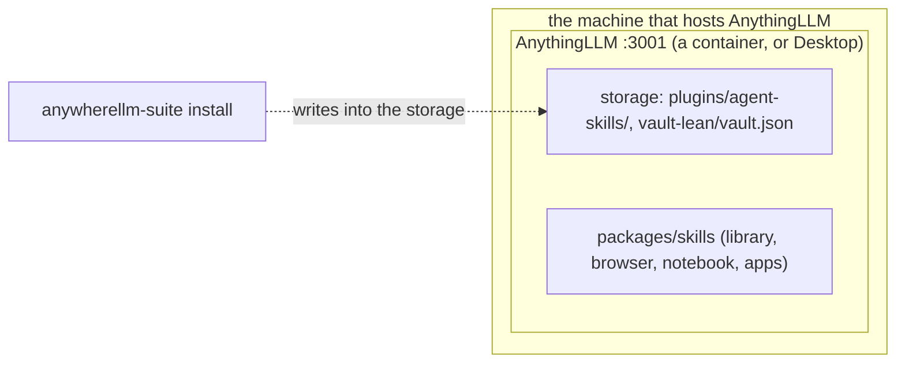

# Architecture

- **Nothing of the suite runs beside AnythingLLM.** `install` writes the skills into AnythingLLM's storage folder (or AnythingLLM imports one from its Community Hub), and AnythingLLM loads them into its own process. The same files work for a container and for Desktop.
- **Who holds which secret:** AnythingLLM's password (`AUTH_TOKEN`) stays with AnythingLLM, and no skill reads it. The skills' pages post with a browser-extension key the user makes once in Settings › Browser Extension and pastes into one skill's `PAGE_KEY` (`shared/pagekey.mts`: that setting, then the vault, then `install --page-key`), kept in the vault (install's in its own file). A service's key is given in the library's own settings (`NEW_KEY`), or on the Vault page, and kept in the vault.
- **The pages' theme:** every page the skills publish (the Library, the Vault, the artifacts manager, the browser's tab and each artifact) follows the device's light or dark setting, and its high-contrast setting, as they change. The Library, the Vault, the manager and the tab share AnywhereLLM Lite's colours (`packages/shared/themes.test.mts` keeps them one list). Each artifact's page carries the same House UI block, from the Vault's page at build (`build.mjs`'s `PAGE_LIBRARIES`), and the scheme its `<html data-scheme>` names. `?theme=light` or `dark` in its address keeps it to one (an artifact's page takes `light-hc` and `dark-hc` too), and a client showing it can switch it while open by setting `data-theme` on its `<html>` to `light` or `dark`, or removing it to follow the device again.
- **The pages draw no title or Close of their own** (since 2026-10-31): they open in a sheet, AnywhereLLM Lite's Custom Tab, whose toolbar shows the page's `<title>` and a Close, and in a plain browser tab the browser's Back and tab close do the same. A page's own screens (a function, a machine being added, an app, the trash) keep their Back.
- **The phone app's bridge** (AnywhereLLM Lite) and **the control server** (the agent's chat and scheduled-job tools) are a separate repository, anywherellm-bridge, with its own install.
