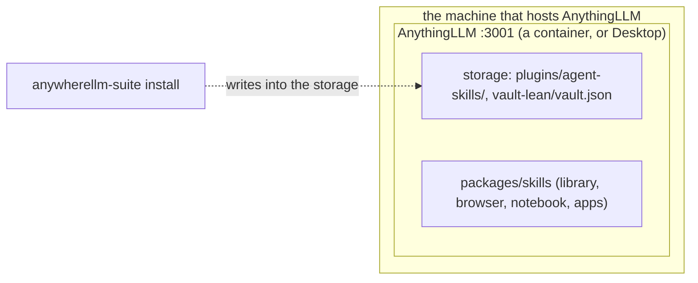

# Architecture

- **Nothing of the suite runs beside AnythingLLM.** `install` writes the skills into AnythingLLM's storage folder (or AnythingLLM imports one from its Community Hub), and AnythingLLM loads them into its own process. The same files work for a container and for Desktop.
- **Who holds which secret:** AnythingLLM's password (`AUTH_TOKEN`) stays with AnythingLLM, and no skill reads it. The skills' pages post with a browser-extension key the skills find or make (`shared/pagekey.mts`: their `PAGE_KEY` setting, the vault, `install --page-key`, or one made with AnythingLLM's own model), kept in the vault (install's in its own file). A service's key is given in the library's own settings (`NEW_KEY`), or on the Vault page, and kept in the vault.
- **The pages' theme:** every page the skills publish (the Library, the Vault, the artifacts manager, the browser's tab and each artifact) follows the device's light or dark setting, and its high-contrast setting, as they change. The Library, the Vault, the manager and the tab share AnywhereLLM Lite's colours (`packages/shared/themes.test.mts` keeps them one list). `?theme=light` or `dark` in its address keeps it to one, and a client showing it can switch it while open by setting `data-theme` on its `<html>` to `light` or `dark`, or removing it to follow the device again.
- **The phone app's bridge** (AnywhereLLM Lite) and **the control server** (the agent's chat and scheduled-job tools) are a separate repository, anywherellm-bridge, with its own install.
